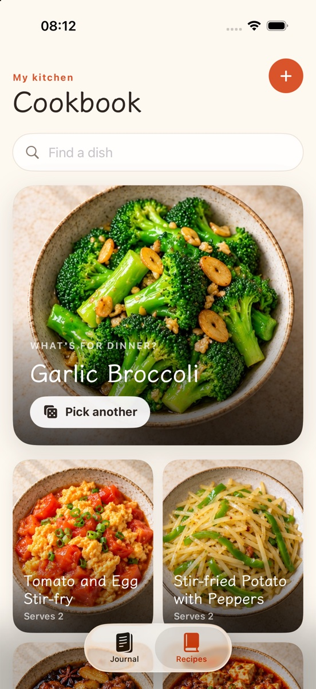

# 家常 · At Our Table

**一本会随日子变厚的厨房手记**

记住怎么做，也记住为什么做。

<p align="center">
  
  &nbsp;&nbsp;
  
</p>

## 打开它，就像翻开一本自己的本子

厨房里真正留下来的，往往不是某道菜的精确克数，而是那天为谁做饭、盐放多了一点、窗外正好下雨。

家常是一本离线的中英双语手记。打开就有十六道家常菜和它们的照片，不用注册，不用联网，也不会问你问题。你做的每一顿饭，可以单独记成一页：日期、为谁做的、这次有什么不同，想的话再配一张照片。日子久了，这本手记会自然变厚。

打算认真做一道菜的时候，点「开始做饭」，它会变成全屏的烹饪模式：一步一屏的大字、可以勾掉的食材清单，还有一个做饭时才需要的计时器。离开 app 计时会暂停，回来自己继续——它不是后台的闹钟，只是桌上的一只表。

中文和 English 随时切换，同一道菜在两边都读得通。

## 为什么会写它

> 这里记录着我做过的饭菜，也收藏着一些平凡日子里的温暖。我始终相信，食物不只是味道，也能传递关心与幸福。
>
> 菜谱里的时间和分量只是参考。你可以按照自己的喜好调整，也可以慢慢找到属于自己的味道。
>
> 希望这些菜谱，能为你的餐桌带去一点温暖。
>
> —— Brook

## 你的东西，只在你手里

家常没有账号，没有后端，没有分析统计，也没有广告。你写的菜谱、手记和照片，都放在这台 iPhone 上家常自己的空间里，和你其他的 app 隔开，也会跟着正常的手机备份走。

只有你主动为菜谱拍照时，才会请求相机权限；选照片用的是系统相册选择器，家常只看得到你选中的那一张。删掉 app，本机上的内容也会一起离开。

内置的十六道菜会随版本更新慢慢增加。你改过的、删掉的，永远以你为准；哪天想找回原版，菜谱菜单里有「恢复原版」，设置里也能找回删掉的内置菜。

## 给想动手的人

<details>
<summary>环境、构建与维护</summary>

需要 macOS、Xcode 16 以上、iOS 18 以上的设备，以及 [XcodeGen](https://github.com/yonaskolb/XcodeGen)：

```bash
brew install xcodegen
git clone https://github.com/BrookZeng2023/jiachang.git
cd jiachang/app
xcodegen generate && open jiachang.xcodeproj
```

装到真机之前，在 Xcode 里选一下自己的开发团队。

**加一道内置菜**：在 `app/jiachang/Resources/Catalog/recipes.json` 里写一条（`id` 一旦发布就不能再改），把照片放到 `images/<key>.jpg`，把 `project.yml` 的版本号加一，跑完测试再发版。文案用 `中文 · English` 的写法，app 只显示当前语言那一半。

**字体**：文楷负责故事，新晰黑负责阅读，系统字负责操作。两套字体是从 LXGW 文楷 GB 和霞鹜新晰黑裁出来的改名子集，只保留常用字和界面文案；少见的字会回退到系统字体。改过文案后需要重跑 `app/scripts/build_fonts.py`，仓库里有用法和许可证说明。

**测试**：

```bash
cd app
IOS_DESTINATION='platform=iOS Simulator,name=iPhone 17 Pro' ./scripts/check.sh
```

它会重新生成工程、编译，并检查几件要紧的事：内置菜谱完整、你的修改能跨版本保留、手记跟着菜谱走、旧数据能无损升级、计时器只响一次。模拟器上还有一个界面冒烟测试，走一遍「写一页手记 → 重启 → 找到它 → 进烹饪模式」。真机上请只做安装验证，不要往手机里写测试数据。

**发版**：

```bash
cd app
scripts/release.sh          # 先跑测试，再归档并上传 TestFlight
```

构建号取 git 提交数，上传成功后自动打 `build/<版本>-<构建号>` 标签。私钥只放在解锁的 PrivateVault 里，仓库和 `release.local.env` 都不含密钥本身。

```
app/                 iOS 源码、内置菜谱、工程配置、脚本与测试
docs/screenshots/    公开截图
DESIGN.md            视觉与工程上的取舍
```

</details>

## 许可

代码以 MIT 发布，见 [LICENSE](LICENSE)。内置菜谱的照片由 AI 生成；你自己添加的照片仍然属于你，不会因为放进家常就变成 MIT 授权。字体遵循各自的 SIL OFL 1.1 与 IPA Font License 1.0，许可证全文随 app 附带。
